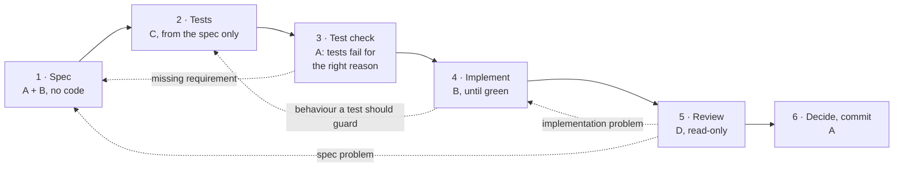

# GalerkinDemo

Variance reduction for lattice correlators by solving a **Stein–Poisson equation with a Galerkin method**, written in Julia with a **spec-driven, test-gated workflow of AI coding agents** (Claude Code).

The repository shows two things:

1. **The method.** A correlator is rewritten as the response of the theory to a source. Solving a linear PDE on configuration space (the Stein–Poisson equation) in a finite basis gives a control variate that leaves the mean unchanged and removes noise. In the free theory the level-1 basis is exact, and the improved estimator has zero variance on every configuration. [→ Section 1](#1-the-method)
2. **The process.** Every feature goes through a written specification, tests written blind from that specification, an implementation that may not touch the tests, and a read-only review. Four roles are separated by files on disk, never by a shared chat. [→ Section 2](#2-the-process-spec-driven-agentic-development)

| | |
|---|---|
| Method, all formulas | [`GALERKIN.md`](GALERKIN.md) |
| Specifications (one per feature) | [`specs/`](specs/) |
| Tests (one file per spec, one testset per acceptance criterion) | [`test/`](test/) |
| Implementation | [`src/`](src/) |
| Rules for the agents | [`CLAUDE.md`](CLAUDE.md), [`CONVENTIONS.md`](CONVENTIONS.md), [`.claude/agents/`](.claude/agents/) |
| Analysis on real configurations | [`applications/sketchbook.jl`](applications/sketchbook.jl) |

---

## 1. The method

### 1.1 The problem: noise in correlators

On a periodic $T\times L$ lattice with a real scalar field $z(t,x)$ and distribution $p(z)\propto e^{-S(z)}$, the zero-momentum correlator is

$$
C(t)=\mathrm{Cov}\big(\Pi(t),\Pi(0)\big),\qquad \Pi(t)=\sum_x z(t,x).
$$

The standard estimator is $U_t=\Delta\,\Pi(t)$, with $\Delta=\Pi(0)-\langle\Pi(0)\rangle$. The signal decays as $C(t)\sim e^{-mt}$. The variance of $U_t$ approaches the constant $\langle\Delta^2\rangle\langle\Pi(t)^2\rangle$ at large $t$. The relative error therefore grows exponentially with $t$.

### 1.2 The correlator as a response, and the Stein–Poisson equation

Add a source to the action, $S_\epsilon=S-\epsilon\,\Pi(0)$. The correlator is the linear response

$$
C(t)=\partial_\epsilon\langle\Pi(t)\rangle_\epsilon\big|_{\epsilon=0},\qquad p_\epsilon=p\,(1+\epsilon\Delta)+O(\epsilon^2).
$$

Instead of reweighting, move the configurations, $z\mapsto z+\epsilon\nabla\Phi(z)$, so that the transported distribution is $p_\epsilon$. To first order this requires

$$
\mathcal L\Phi+\Delta=0,\qquad \mathcal L\Phi=\nabla^2\Phi-\nabla S\cdot\nabla\Phi .
$$

$\mathcal L$ is the **Stein operator** of $p$. It satisfies $\langle\mathcal L h\rangle=0$ for every $h$, and more generally $\langle\mathcal T g\rangle=0$ with $\mathcal T g=\nabla\cdot g-g\cdot\nabla S$.

### 1.3 The improved estimator

For any trial function $\Phi$, define the residual and the improved estimator

$$
R=\Delta+\mathcal L\Phi,\qquad
\hat A_t=U_t+\mathcal T\big(\Pi(t)\nabla\Phi\big)=R\,\Pi(t)+f_t,\qquad
f_t=\nabla\Phi\cdot\nabla\Pi(t).
$$

- **No bias, for any $\Phi$:** $\langle\hat A_t\rangle=C(t)$, because $\langle\mathcal T g\rangle=0$. A poor $\Phi$ costs variance, never correctness.
- **Noise reduction:** the term $R\,\Pi(t)$ carries the noise that does not decay with $t$. The better $\Phi$ solves the equation, the smaller $R$.
- **Exact solution:** if $R\equiv0$ then $\hat A_t=f_t$. For a $\Phi$ linear in $z$, $f_t$ is a constant, so the estimator has zero variance.

### 1.4 Galerkin solution

Expand $\Phi$ in $M$ basis functions $\psi_j$ and write the source in the same basis:

$$
\Phi=\sum_{j}\alpha_j\psi_j,\qquad \Delta=\sum_j s_j\big(\psi_j-\langle\psi_j\rangle\big),\qquad
R(\alpha)=\Delta+\sum_j\alpha_j\,\mathcal L\psi_j .
$$

$R\equiv0$ cannot be imposed in a finite basis, so we require $M$ conditions $\mathrm{Cov}(\chi_i,R)=0$. All the needed quantities are sample averages over the Monte Carlo configurations:

$$
B_{ij}=\mathrm{Cov}(\psi_i,\psi_j),\qquad
A^{\rm grad}_{ij}=\big\langle\nabla\psi_i\cdot\nabla\psi_j\big\rangle,\qquad
A^{\rm ibp}_{ij}=-\mathrm{Cov}(\psi_i,\mathcal L\psi_j),\qquad
Q_{ij}=\mathrm{Cov}(\mathcal L\psi_i,\mathcal L\psi_j).
$$

$A^{\rm grad}$ and $A^{\rm ibp}$ are two estimates of the same matrix (they are equal in expectation by integration by parts), but they differ on a finite sample. The three solvers implemented here are

$$
\alpha_{\rm grad}=\big(A^{\rm grad}\big)^{-1}Bs,\qquad
\alpha_{\rm ibp}=\big(A^{\rm ibp}\big)^{-1}Bs,\qquad
\alpha_{\rm vm}=Q^{-1}\big(A^{\rm ibp}\big)^{\top}s .
$$

The first two are Galerkin conditions ($\chi_i=\psi_i$). The third is minimum variance ($\chi_i=\mathcal L\psi_i$), which is the least-squares fit of $-\Delta$ on the features $\mathcal L\psi_j$. When $\mathcal L$ maps the span outside itself (leakage), minimum variance gives the smaller residual variance.

### 1.5 Free theory: an exact test bed

For $S=\tfrac12 z^\top Kz$ with $K=2-2\kappa\,(\text{nearest-neighbour hopping})$, take the **level-1 basis** of slab sums, $\psi_j=\Pi(j)$, $j=0,\dots,T-1$. Since $\nabla\psi_j$ is constant and $\nabla^2\psi_j=0$, the Stein operator closes on the basis:

$$
\mathcal L\psi_j=-\sum_x(Kz)(j,x)=-\sum_i K^{(0)}_{ij}\,\psi_i,\qquad
K^{(0)}_{ij}=(2-4\kappa)\,\delta_{ij}-2\kappa\,(\delta_{i,j+1}+\delta_{i,j-1}).
$$

This identity holds **pointwise**, so its consequences hold exactly on any finite sample with $N>T$, Gaussian or not:

$$
\hat A^{\rm ibp}=\hat B\,K^{(0)},\qquad \hat Q=K^{(0)}\hat B\,K^{(0)},\qquad
\hat A^{\rm grad}=L\,\mathbb 1 .
$$

| solver | coefficients on a sample | residual | improved estimator |
|---|---|---|---|
| ibp | $G^{(0)}_{\cdot 0}$, exact ($G^{(0)}=(K^{(0)})^{-1}$) | $R\equiv0$ | $\hat A_t=L\,G^{(0)}_{t0}=C(t)$ on every configuration |
| vm | $G^{(0)}_{\cdot 0}$, exact | $R\equiv0$ | same |
| grad | $\hat B_{\cdot0}/L$, inherits the noise of $\hat B$ | $R\neq0$ | unbiased; $R$ shrinks as $\hat B$ converges |

In $\hat A^{\rm ibp}$ the noise of $\hat B$ cancels between the two sides of the linear system. $\hat A^{\rm grad}$ has no noise, so this cancellation cannot happen. The free theory therefore separates the three solvers by an exact, testable statement, which is why it comes first.

### 1.6 Interacting theory

For the $\lambda\phi^4$ action of [spec 002](specs/002-lambdaphi4.md), the force contains $4\lambda z^3$. Then $\mathcal L\psi_j$ contains $\sum_x z(j,x)^3$, which lies outside the level-1 span. The level-1 solution is still unbiased and still reduces the variance, but $R\neq0$. The next step is a nested basis ($\Pi$, then $\sum_x z^3$, ...) generated by applying $\mathcal L$ repeatedly. [`applications/sketchbook.jl`](applications/sketchbook.jl) applies the level-1 solvers to interacting configurations and plots the variance-reduction factor $(\sigma_{\rm base}/\sigma_{\rm improved})^2$ against $t$ for the three solvers.

<!-- Figure: run applications/sketchbook.jl, save the final plot, and link it here, e.g.
 -->

Errors are computed with the Γ-method ([ADerrors.jl](https://igit.ific.uv.es/PlaquetteArchive/simulation_codes/aderrors.jl)), which accounts for autocorrelations. The improved correlator and the control variate share the ensemble id of the plain correlator, so their correlations propagate correctly.

---

## 2. The process: spec-driven agentic development

### 2.1 Four roles

| Role | Who | Reads | Writes |
|---|---|---|---|
| **A** | me | everything | the decision and the commit; I classify every problem |
| **B** worker | Claude Code, main session | spec, conventions, `src/`, `test/` | the spec (with A), then `src/` only; never `test/`, never `applications/` |
| **C** test-writer | separate session, [`tester.md`](.claude/agents/tester.md) | the spec and `CONVENTIONS.md`; **not** `src/` | `test/` only |
| **D** reviewer | separate session, [`reviewer.md`](.claude/agents/reviewer.md) | `git diff main`, the spec, the conventions | nothing: read-only report |

B and C never share a chat, and neither do B and D. The only things passed between them are files on disk. The test-writer cannot see the implementation, so the tests encode the specification, not the code. The worker cannot edit the tests, loosen a tolerance, change a seed or skip a test, so a test can only turn green by fixing the code ([`CLAUDE.md`](CLAUDE.md)).

### 2.2 The cycle



Rule of thumb: **the arrow points back to the layer where the wrong decision was made.** A wrong test is never fixed by changing the code, and a wrong spec is never fixed by changing a test.

The intended commit pattern is one commit per layer: the spec, then the tests (red), then the implementation (green). Spec 004 shows it:

```
c31054e  Spec 004                   specs/004-level1-solver.md
a6f6669  Test for 004               test/test_004_level1_solver.jl, test/runtests.jl
5c52655  Spec 004 implementation    src/GalerkinDemo_level1.jl, src/GalerkinDemo.jl
```

### 2.3 What a spec contains

Every spec follows [`specs/TEMPLATE.md`](specs/TEMPLATE.md): **Goal, Interface, Formulas, numbered Acceptance criteria, Out of scope, Open questions**. Open questions must be empty before tests are written. Each criterion states its numbers, tolerance and random seed, because the worker is not allowed to change them later.

Example, from [spec 003](specs/003-level1-basis.md):

> **AC-3: Stein operator vs ForwardDiff.** Random `z`, `κ = 0.1`, `λ = 0`. Formula used (GALERKIN.md §1.4): `ℒψ_j = tr Hess ψ_j − ∇S·∇ψ_j` ... Here `∇S = ForwardDiff.gradient(action_slice(0.0, 0.1), z)` (gradient of the action, not `grad_slice`) ... to 1e-12.
>
> **AC-4: closure.** Same `z`. Formula used (...): `ℒψ_j = −Σ_i K0_ij ψ_i`, `K0_ij = (2 − 4κ) δ_ij − 2κ (δ_{i,j+1} + δ_{i,j−1})`, indices mod `T`. The test builds the `4 × 4` periodic matrix `K0` itself (helper in the test file, with `κ = 0.1`) ... to 1e-12.

The test written by C from that text:

```julia
@testset "AC-3: Stein operator vs ForwardDiff" begin
    z = randn(_rng003(), 4, 3)
    s = stein_psi(z, 4, _p003)
    @test size(s) == (4,)

    ∇S = ForwardDiff.gradient(action_slice(0.0, 0.1), z)
    for j in 0:3
        ψj = _ψ003(j)
        ref = tr(ForwardDiff.hessian(ψj, z)) - sum(∇S .* ForwardDiff.gradient(ψj, z))
        @test isapprox(s[j+1], ref; rtol=1e-12, atol=1e-12)
    end
end
```

### 2.4 How the tests are designed

- **Exact identities instead of statistics.** The free theory provides identities that hold on any sample, such as $\hat A^{\rm ibp}=\hat BK^{(0)}$, $\alpha_{\rm ibp}=G^{(0)}_{\cdot0}$ and $R\equiv0$. They can be tested to $10^{-12}$ with no statistical tolerance to argue about.
- **An independent reference for each derivative.** Gradients, Laplacians and the Stein operator are compared with automatic differentiation (ForwardDiff) of the *action*, so a sign error in the hand-written force cannot hide.
- **Hand anchors.** Every spec has at least one criterion whose expected values are computed by hand, e.g. a constant field gives $\mathcal L\psi_j=-L(2-8\kappa)c$.
- **Traps for common bugs.** $T\neq L$ catches swapped axes. Batch results must equal the single-configuration results, and changing one configuration must not change the others. Element types must pass through (`Float32`, dual numbers).

### 2.5 What the process caught

These issues surfaced at the spec or test stage, and the resolutions are recorded in the specs:

- **ADerrors reads a 2-element data vector as `[value, error]`,** not as two samples. Spec 001 now requires $N\ge3$ configurations and validates it ([spec 001, Notes](specs/001-correlator-and-errors.md)).
- **The default Γ-method window fails on very short histories** ($N=10$). The test sample size was raised to $N=20$, and the spec says so instead of letting the code hide the failure.
- **Single source versus averaged source.** [`GALERKIN.md`](GALERKIN.md) derives the estimator for one source at $t=0$, while the correlator of spec 001 averages over all source positions. Spec 005 averages the improved estimator in the same way, by rolling configurations in time (exact, by translation invariance). Then *plain correlator + control variate = improved correlator* holds exactly, and spec 005 tests it, including equal ADerrors error bars.

---

## 3. Specifications

| Spec | Content | State |
|---|---|---|
| [001](specs/001-correlator-and-errors.md) | Slab sums, correlator, Γ-method errors (ADerrors), plotting helpers | implemented, tested |
| [002](specs/002-lambdaphi4.md) | $\lambda\phi^4$ action and force on batches; force checked against AD and finite differences | implemented, tested |
| [003](specs/003-level1-basis.md) | Level-1 basis, gradient, Laplacian, Stein operator; closure in the free theory | implemented, tested |
| [004](specs/004-level1-solver.md) | Matrices $B, A^{\rm grad}, A^{\rm ibp}, Q$; the three solvers; residual | implemented, tested |
| [005](specs/005-improved-estimator.md) | Improved estimator $\hat A_t$ and control variate as `uwreal`s; zero-variance check | implemented, tested except AC-4 (metrics), which is the next cycle |

## 4. Repository layout

```
GalerkinDemo/
├── GALERKIN.md                 # the method: every formula, with derivations
├── CLAUDE.md                   # rules for the worker agent (B)
├── CONVENTIONS.md              # language, normalisations, test style, errors
├── .claude/agents/
│   ├── tester.md               # test-writer agent (C)
│   └── reviewer.md             # reviewer agent (D)
├── specs/
│   ├── TEMPLATE.md
│   └── 001-...005-*.md
├── src/
│   ├── GalerkinDemo.jl         # correlator and errors (001), λφ⁴ action and force (002)
│   └── GalerkinDemo_level1.jl  # basis (003), solvers (004), improved estimator (005)
├── test/
│   ├── runtests.jl
│   └── test_001-...005_*.jl    # one file per spec, one testset per criterion
└── applications/
    └── sketchbook.jl           # analysis on real configurations (outside the agents' scope)
```

## 5. Running

Requires Julia ≥ 1.10. ADerrors.jl is installed from its git repository through the pinned `Manifest.toml`.

```bash
julia --project -e 'using Pkg; Pkg.instantiate(); Pkg.test()'
```

`applications/sketchbook.jl` reads my own λφ⁴ ensembles, which are not included in the repository, and additionally uses JLD2.

## 6. Next steps

- **Spec 005, AC-4:** sample diagnostics, the Stein-identity violation $\overline{\mathcal L\Phi}$ and the integration-by-parts violation $\lVert\hat A^{\rm grad}-\hat A^{\rm ibp}\rVert_F$.
- **Nested basis** for the interacting theory ($\Pi^{(3)}$, $\Pi^{(5)}$, nearest-neighbour composites), with exact tests that each level's matrices are the leading blocks of the next level's.
- **Statistics for larger bases:** cross-fitting on contiguous blocks of the Monte Carlo chain, ridge regularisation, and conditioning diagnostics.
